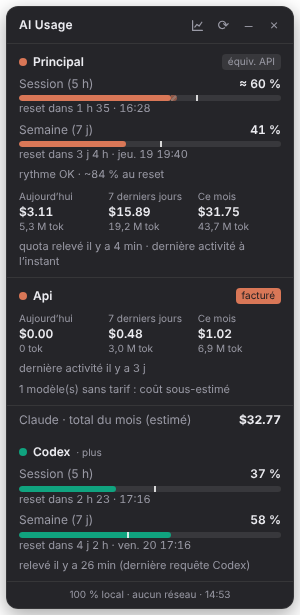
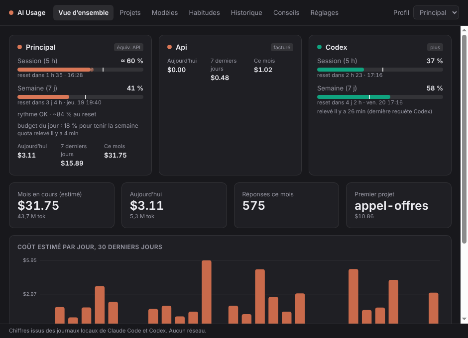

# AI Usage Widget

Petit widget Windows, toujours au premier plan, et son tableau de bord : ils affichent votre consommation **Claude** et **Codex (OpenAI)**, la projettent, et vous alertent avant la limite.

**100 % local** : l'application lit uniquement des fichiers déjà présents sur votre PC. Aucun identifiant, aucun cookie, aucun appel réseau (toutes les requêtes sont bloquées dans `main.js`, et un test automatique le vérifie).

| Widget | Tableau de bord |
|---|---|
|  |  |

## Ce qu'il affiche

| Donnée | Source locale | Fraîcheur |
|---|---|---|
| % officiel Claude, session 5 h et semaine 7 j | `<profil>/statusline-last.json`, écrit par le relais (voir plus bas) | À chaque réponse de Claude Code |
| Estimation entre deux relevés (valeur précédée de `≈`) | Journaux `<profil>/projects/**/*.jsonl` + ratio appris sur vos relevés passés | Toutes les 30 s |
| Coût estimé, par jour, projet et modèle | Mêmes journaux, grille `pricing.json` | Toutes les 30 s |
| % officiel Codex + date de reset | `~/.codex/sessions/**/*.jsonl` (événements `token_count`) | À la dernière requête Codex |

Sur chaque barre, le trait marque le rythme régulier : si la barre le dépasse, vous consommez plus vite que la fenêtre ne le permet. La partie hachurée est l'estimation ajoutée au dernier relevé officiel.

Sous les barres, une ligne annonce soit l'heure probable d'atteinte de la limite, soit le niveau attendu au reset, soit le « budget du jour » pour tenir la semaine.

### Limites à connaître

- Seule l'utilisation via Claude Code et Codex laisse des journaux. L'usage dans claude.ai, Cowork ou ChatGPT n'apparaît que dans le % officiel, au relevé suivant.
- L'estimation `≈` ne voit que ce PC, et n'existe qu'après trois relevés exploitables. Tant qu'elle n'est pas calibrée, seul le relevé officiel est affiché.
- Les coûts sont des estimations aux prix publics de l'API. Pour un forfait, c'est un équivalent, pas ce que vous payez. La grille de prix est à vérifier et à tenir à jour vous-même.

## Tableau de bord

Bouton graphique du widget, ou clic droit sur l'icône de la barre système.

| Onglet | Contenu |
|---|---|
| Vue d'ensemble | Jauges et prévision par profil, coût du mois, coût par jour sur 30 jours, sessions actives avec taille du contexte |
| Projets, Modèles | Coût estimé, part, tokens, réponses ; export CSV |
| Habitudes | Carte jour × heure des 28 derniers jours |
| Historique | Relevés officiels sur 24 h à 90 jours, graphique ou tableau, export CSV |
| Conseils | Règles calculées localement : modèle haut de gamme sur tâches courtes, contexte trop chargé, cache, forfait sous ou sur-dimensionné |
| Réglages | Profils, relais, alertes, thème, langue (français, anglais), raccourci, grille de tarifs, rapport |

Le rapport est une page HTML autonome (sans script ni lien externe), générée localement et enregistrée où vous voulez.

## Profils Claude

Chaque dossier de configuration Claude Code (`~/.claude`, `~/.claude-<nom>`, choisi via `CLAUDE_CONFIG_DIR`) est un profil. Ils sont détectés automatiquement ; vous pouvez les renommer, changer leur type ou en ajouter dans **Réglages**. Type `forfait` : abonnement avec quotas. Type `api` : facturé à l'usage, sans quota.

## Relevé du quota officiel (relais status line)

Claude Code transmet `rate_limits` à la commande de status line pour les forfaits. Le relais est un script de quelques lignes qui enregistre cette entrée, telle quelle, dans `<profil>/statusline-last.json`. Il n'analyse rien et n'envoie rien.

- **Aucune status line configurée** : bouton **Installer** dans Réglages. `settings.json` est sauvegardé dans `settings.json.ai-usage-backup` avant modification, et **Désinstaller** remet l'état précédent.
- **Status line déjà en place, macOS ou Linux** : le relais s'installe devant elle et lui repasse l'entrée ; votre affichage ne change pas.
- **Status line déjà en place, Windows** : l'application ne touche à rien et affiche deux lignes à ajouter à votre script.

L'ancien fichier `~/.claude/rate-limits.json` (format v1) reste lu.

## Alertes

Notifications Windows, une seule fois par fenêtre : seuil d'avertissement, seuil critique, limite prévue avant le reset, et « session réinitialisée » après une session presque épuisée. Rien n'est émis au démarrage pour ce qui est déjà à l'écran.

## Grille de tarifs

Ordre de recherche : fichier désigné par `AI_USAGE_PRICING`, puis votre copie `%APPDATA%\AI-Usage-Widget\pricing.json` (bouton **Créer / ouvrir ma copie**), puis la grille fournie `src/collectors/pricing.json` (aussi lue par le panneau Herdr `claude-usage`). Les modèles absents de la grille sont signalés dans le widget et dans Conseils au lieu d'être comptés à 0 $ en silence.

## Confidentialité

- Seuls des compteurs sont lus : heure, modèle, nombre de tokens, dossier de projet, identifiant de session. Le texte des conversations n'est jamais conservé, affiché ni exporté (vérifié par les tests).
- Données de l'application : `%APPDATA%\AI-Usage-Widget\` (`settings.json`, `state.json` pour l'historique des relevés, éventuellement `pricing.json`).
- Seule écriture hors de ce dossier : le relais, sur clic explicite.

## Utilisation

- `Ctrl+Alt+U` : afficher / masquer (modifiable).
- Clic sur l'icône de la barre système : afficher / masquer. L'icône affiche le % de session le plus élevé ; le survol résume les profils.
- La fenêtre se déplace par son titre ; la position est mémorisée.

## Développement

```bash
npm install
npm start          # lancer sur vos vrais journaux
npm run demo       # lancer sur un faux dossier personnel généré (aucune donnée réelle)
npm test           # tests unitaires
npm run test:e2e   # pilote l'application réelle sur de faux journaux (Linux : xvfb-run -a)
npm run lint
npm run build      # dist/AI-Usage-Widget-<version>-portable.exe
```

Nécessite Node.js 20+.

```
main.js                  fenêtres, icône, raccourci, IPC, blocage réseau
preload.js               pont minimal vers l'interface
src/collectors/          lecture des journaux : jsonl (incrémental, non bloquant), claude, claude-official, codex, profiles, pricing
src/core/engine.js       assemble collecte, estimation, prévision, historique, alertes (sans Electron, testable)
src/core/                forecast, calibration, alerts, history, insights, statusline, settings, report, i18n, tray-icon
src/renderer/            widget (index.html, app.js) et tableau de bord (dashboard.*)
test/                    tests unitaires, générateur de faux journaux, test de bout en bout
```

Outil non officiel, sans lien avec Anthropic ni OpenAI. Licence MIT.
